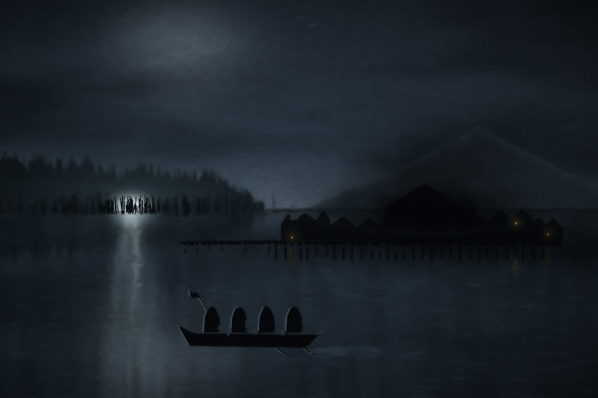

# Nachtfall in Esgaroth



Ein Abenteuer für *The One Ring, 2nd Edition* · Esgaroth und der Lange See, Herbst TA 2966.

Ein One-Shot für 3–4 Spieler (4–5 Stunden) mit vier vorgefertigten Zwergen aus Erebor. Beim Fest
in der Großen Halle von Esgaroth stirbt ihr Herr in einer unnatürlichen Finsternis, und das Erbstück
seines Hauses wird gestohlen. Über dem Toten schwören die Helden einen Eid in eigenen Worten, und das
Abenteuer prüft ihn Satz für Satz. Frei inspiriert vom Lied „Nightfall“ von Blind Guardian.

Dieses Repository enthält den Text des Abenteuers und die Pipeline, die daraus die
Druckfassung baut. Sie ist von [tor2e-graufieber](https://github.com/Andx667/tor2e-graufieber) übernommen,
das sie von [tor2e-finsterwacht](https://github.com/Andx667/tor2e-finsterwacht) hat. Bei jedem Commit baut GitHub Actions die PDFs (Reiter **Actions** → letzter Lauf →
Artefakte `Nachtfall-TOR2e-DE-v….pdf` und `Nachtfall-TOR2e-DE-Buch-v….pdf`).

## Aufbau

| Pfad | Inhalt |
| --- | --- |
| `src/nachtfall.md` | Der Abenteuertext (Pandoc-Markdown) – hier wird geschrieben |
| `NOTICE.md` | Wem die Namen und Inhalte gehören und was die MIT-Lizenz abdeckt |
| `assets/cover-de.jpg` | Titelbild der Buchfassung (gemalt von `tools/cover.py`) |
| `assets/maps/` | Die gezeichneten Karten als JPG, Quellen als SVG in `svg/` |
| `assets/route-de.*` | Das Routendiagramm im Überblick |
| `latex/nachtfall.sty` | Das Layout: Ränder, Notizspalte, Kästen, Tabellen, Karten, Handouts |
| `latex/nachtfall.tex` | Gerüst der Blattfassung (einseitig, links gelocht) |
| `latex/nachtfall-buch.tex` | Gerüst der Buchfassung (Buchblock zum Binden) |
| `latex/inhalt.tex` | Inhalt beider Fassungen (Titel, Gegenstandskarten, Karten, Eidkarte, Handouts) |
| `filters/nachtfall.lua` | Pandoc-Filter: Markdown-Elemente → Layout-Bausteine |
| `tools/build.py` | Baut das PDF |
| `tools/cover.py` | Malt das Titelbild neu (numpy, OpenCV) |
| `tools/maps.py` | Zeichnet Karten und Routendiagramm neu (optional, braucht Playwright und Pillow) |
| `.github/workflows/build.yml` | CI: baut das PDF bei jedem Commit |

## Schreibregeln im Markdown

- `## Kapitel {#id}` beginnt ein Kapitel auf neuer Seite mit Notizspalte;
  `{#id .nonotes}` setzt es ohne Notizspalte in voller Breite.
- `### Abschnitt` ist eine Zwischenüberschrift.
- Absätze, die mit einem dieser fetten Labels beginnen, werden zu Kästen:
  **Hinweis für den Loremaster:**, **Optionale Erweiterung – …:**,
  **Erinnerung für den Loremaster – …:**, **Möglicher Abschluss:**,
  **Wenn sie …:** (z. B. **Wenn sie trotzdem gehen:**), **Erfahrung:**
- Ein Absatz **Hausregel – …:** mit folgender Liste und folgendem Absatz wird zum
  gerahmten Hausregel-Kasten.
- Die Wörter `Optional` und `Überspringbar` werden zur grauen Markierung.
- Karten im Text: `{.map}`,
  das Routendiagramm mit `{.route}`.
- Briefe: `::: {.letter #id} … :::` mit `\` am Zeilenende und `[Unterschrift]{.sig}`;
  sie erscheinen im Text und zusätzlich als Handout-Seite (`\fwhandoutletter` in `latex/inhalt.tex`).
- Tabellen: normale Pipe-Tabellen; die Spaltenbreiten richten sich nach dem ersten
  Spaltenkopf (siehe `TABLES` im Filter).
- Regelbegriffe kursiv (`*Insight*`), Tolkien-Namen und Regelbegriffe bleiben englisch.
- `★` hinter einer Fertigkeit wird zum roten Stern (favorisierte Fertigkeit auf den Bögen).

## Version und Stand

Version und Datum in der Fußzeile kommen aus git: die Nummer des letzten Tags (`v1.0` →
**Version 1.0**) und das Datum des letzten Commits. Der Dateiname nennt die genaue Version
(`…-v1.0.pdf`, danach `…-v1.0+3-abc1234.pdf`). Ein Tag `v*` erzeugt zusätzlich ein
GitHub-Release mit beiden PDFs:

```sh
git tag v1.1
git push --tags
```

## Blattfassung und Buchfassung

- **Blattfassung** (`Nachtfall-TOR2e-DE-v….pdf`): lose Blätter für den Ordner, 26 mm Rand
  links für die Lochung, Karten und Handouts im Querformat.
- **Buchfassung** (`Nachtfall-TOR2e-DE-Buch-v….pdf`): Buchblock zum Binden, doppelseitig;
  Querseiten stehen gedreht, Notizseiten füllen auf eine durch 4 teilbare Seitenzahl auf.

## Lokal bauen

Voraussetzungen: TeX Live mit LuaLaTeX und `latexmk`, `pandoc`, Python 3.

```sh
make            # beide Fassungen; oder: python3 tools/build.py
make buch       # nur eine Fassung (blatt | buch)
make maps       # Karten neu zeichnen
make cover      # Titelbild neu malen
```

Fehlt LuaLaTeX (`luaotfload`), nimmt das Skript ersatzweise XeLaTeX; fehlen die deutschen
Trennmuster, setzt es Flattersatz. Maßgeblich ist der CI-Build.

## Entstehung mit KI

Dieses Abenteuer wurde mit Hilfe eines KI-Sprachmodells (Claude von Anthropic) geschrieben. Text, Bilder,
Handouts, Layout und Code sind im Gespräch mit dem Modell entstanden; Idee, Vorgaben und Auswahl stammen vom
Autor. Der Hinweis steht auch im PDF, am Ende des Textes.

## Lizenz und Rechte

„Nachtfall in Esgaroth“ ist ein **inoffizielles Fanwerk**, nicht verbunden mit oder gebilligt von
Middle-earth Enterprises, der Tolkien Estate, Sophisticated Games, Free League Publishing. Siehe [NOTICE.md](NOTICE.md). Das Abenteuer darf nicht verkauft werden.

Code, Layout, Karten und der eigene Text stehen unter der MIT-Lizenz, siehe [LICENSE](LICENSE).

## Geschichte

Der erste Entwurf entstand als Claude-Doc („Nachtfall über dem Langen See“). Dieses Repository ist die
maßgebliche Quelle.
